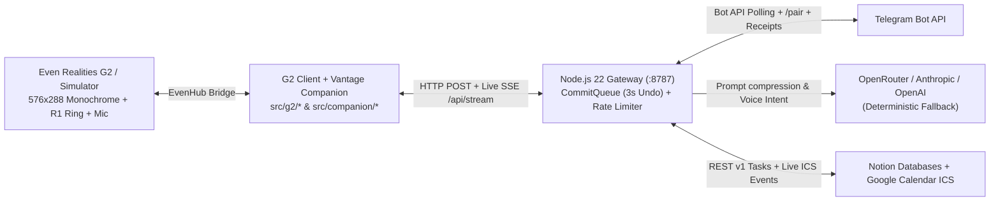

# Cue — Hands-Free Chief-of-Staff HUD for Even Realities G2

**Track:** `04 · AI Assistants & Work` (+ Cross-Track `01 · Messaging & News` & **Best Telegram Integration**)  
**Package ID:** `dev.yashh.cue` · **Built with:** `@evenrealities/even_hub_sdk@0.0.16`, `evenhub-cli@0.2.0`, `evenhub-simulator@0.9.5`, TypeScript, Node.js 22, Vite 8

Cue turns your Even Realities G2 glasses (`576 × 288` monochrome green display, R1 smart ring / temple touchbars, and glasses microphone) into a glanceable **Read-and-Write Chief-of-Staff**: see your next meeting, Notion sprint tasks, and urgent Telegram messages at a glance, then approve AI-drafted replies or compound voice commands in two taps behind a strict **3-second Undo Guard**.

---

## Why Cue Wins on G2 Hardware Constraints

| G2 Hardware / WebView Constraint | How Cue Solves It Cleanly |
| :--- | :--- |
| **Google Sign-In blocked in G2 WebView** | Renders a deterministic `112×112` monochrome `Gray8` QR / pairing matrix + 6-digit code (`PAIR` mode). Pair in 5 seconds via Telegram (`/pair 482910`) or the Companion Web Console. |
| **Monochrome `576×288` glanceable budget** | Never shows cluttered multi-column dashboards: 1 active card, 3 lines (`title`, `subtitle`, `42-col context`), a custom `240×24` `Gray8` urgency timeline bar (`renderHorizonBar`), and up to 3 unclipped 1-tap list items. |
| **Firmware container limits (`zOrderIndex`, single `isEventCapture`)** | Enforces `assertValidG2Payload` + SDK `validateEvenHubPageContainer` before every `createStartUpPageContainer` and `rebuildPageContainer` call, and keeps `menuObject` registered across all transitions. |
| **Safe external writes (Telegram / Notion / Calendar)** | Every outbound write enters a server-side `CommitQueue` **3-Second Undo Guard** (`POST /api/actions/stage`) backed by idempotency keys and Telegram audit receipts — zero unintended messages on accidental temple taps. |
| **No API keys shipped in the `.ehpk` bundle** | All tokens (`TELEGRAM_BOT_TOKEN`, `OPENROUTER_API_KEY`, `NOTION_API_KEY`, `GOOGLE_CALENDAR_ICS_URL`) stay strictly server-side in `.env` or runtime memory. Works 100% offline/out-of-the-box with `[Sandbox Workspace]` + `[DET]` fallback when keys aren't set. |

---

## Architecture



---

## Quick Start (5 Steps)

1. **Install dependencies:**
   ```bash
   npm install
   ```
2. *(Optional)* Copy `.env.example` to `.env` to connect live **Telegram Bot (`@BotFather`)**, **OpenRouter / OpenAI / Anthropic**, **Notion**, and **Google Calendar ICS**. Leave blank to run immediately with the built-in Sandbox Workspace & deterministic fallback engine.
3. **Start the backend gateway (`127.0.0.1:8787`) and Vite frontend (`127.0.0.1:5173`):**
   ```bash
   npm run dev
   ```
4. **Launch inside the official Even Hub Simulator:**
   ```bash
   npx evenhub-simulator --glow http://127.0.0.1:5173
   ```
   Or open `http://127.0.0.1:5173` directly in your browser to use the **Vantage Companion Console** with the live `576×288` optical mirror and hardware gesture deck.
5. **Run automated tests, build, and package `.ehpk`:**
   ```bash
   npm test
   npm run build
   npm run pack:ehpk
   ```
   Produces `cue-g2.ehpk` validated against SDK `0.0.16` (`min_app_version 2.2.10`).

---

## Controls on Even G2 & R1 Ring

- **Scroll Up / Down:** Cycle priority cards (`Calendar -> Telegram -> Notion`).
- **Tap (`CLICK_EVENT`):** Stage selected smart reply, Notion task, calendar shift, or compound dual action into the **3-second Undo Guard** (tap again inside 3s to cancel immediately).
- **Hold (`LONG_PRESS_EVENT` -> `LONG_PRESS_RELEASE_EVENT`):** Stream `AudioEvent` PCM frames to draw a live 24-bar `Gray8` waveform, then compile spoken command into a single confirmed action (e.g., *"Tell Priya 2:40 works & add Notion task lock SDK v2"*).
- **Double Tap (`DOUBLE_CLICK_EVENT`):** Cancel active undo or cycle filter (`All -> Telegram -> Notion`).
- **G2 OS Menu (`MenuItemClickEvent`):** Switch between *Now Brief*, *Telegram Inbox*, *Notion Tasks*, *Voice Command*, and *Pair & Status*.

---

## What Existed Before Nov 23, 2026 (Hackathon Disclosure)

- **Pre-existing open-source runtime/tooling dependencies only:** Node.js, Vite (`vite`), TypeScript (`typescript`), and Even Realities' official SDK/CLI/Simulator packages (`@evenrealities/even_hub_sdk`, `@evenrealities/evenhub-cli`, `@evenrealities/evenhub-simulator`).
- **Built 100% fresh during Heads Up Hackathon (Nov 25, 2026):** All `Cue` source code under `server/`, `src/`, `tests/`, `scripts/`, `docs/`, `app.json`, and the `Vantage` companion interface.
- **Data & Safety Compliance:** Operates read-only / paper-safe with explicit `[Sandbox Workspace]` labeling, zero custodial credentials inside the `.ehpk` package, and atomic state writes.
